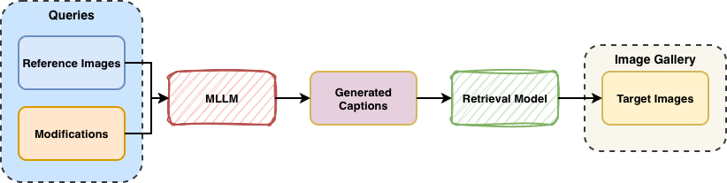

# Composed Image Retrieval for Cultural Heritage Collections

Code for *Composed Image Retrieval for Cultural Heritage Collections through Query Reformulation with Generative Multimodal Large Language Models*.

This training-free pipeline uses Qwen2.5-VL to turn a reference image and a textual modifier into an English target description. OpenCLIP then ranks gallery images by cosine similarity to that description. Experiments on EUFCC-CIR examine the effects of structured materials and object-type metadata, Catalan-to-English translation, and hierarchical information.



## Setup

Use a CUDA-enabled PyTorch environment. The paper's experiments used one NVIDIA A6000 GPU (48 GB).

```bash
git clone https://github.com/StevenXuf/CIR4DH.git
cd CIR4DH
pip install torch torchvision transformers accelerate open_clip_torch torchmetrics \
    fire omegaconf pandas numpy Pillow tqdm matplotlib wordcloud nltk qwen-vl-utils
mkdir -p logs figures
```

The current code also imports [DeepSeek-VL](https://github.com/deepseek-ai/DeepSeek-VL) (`deepseek_vl`) and [BLIP](https://github.com/salesforce/BLIP) (`models.blip_itm`) unconditionally. Install their dependencies and make both modules importable, even for Qwen/OpenCLIP runs. Add your BLIP checkout to `PYTHONPATH`; the path in `feature_extractor.py` is specific to the original environment. Use a Transformers version supporting `Qwen2_5_VLForConditionalGeneration`. Dependency versions are not pinned in this repository.

## Data

The repository includes EUFCC-CIR queries in `cir_db.csv`, gallery IDs and partitions in `db_processed.txt`, and source image URLs in `splits/*.csv`. Images must be downloaded separately.

`downloader.py` provides the download, image-validation, and duplicate-detection utilities. It reads `idInSource` and `#portraitMedia.original` from each split and saves images as `<root>/<split>/<idInSource>.png`. Its download call is commented out in the script entry point; invoke the function directly without changing the source:

```bash
python - <<'PY'
from pathlib import Path
import pandas as pd
from downloader import download_images

root = Path("/path/to/GLAM/raw")  # Choose your image directory.
for split_file in sorted(Path("splits").glob("*.csv")):
    download_images(pd.read_csv(split_file), root / split_file.stem)
PY
```

Set `paths.glam_root` in `config.yaml` to the same image directory. Keep `paths.cir_file` and `paths.db_processed_name` pointing to the supplied query and gallery files. Run commands from the repository root.

Images are searched across `test_id`, `test_ood`, `train`, and `val` directories; only the selected test partition supplies evaluation queries and gallery IDs. No training is performed. The loader filters missing images and, with `remove_duplicates: true`, repeated reference/target pairs. The paper reports 1,435 queries / 2,363 gallery images for `test_id` and 81 / 22,373 for `test_ood` after preprocessing; availability of source images may affect these counts.

## Experiments

**`metrics_computation.py` is the main entry point for the paper's experiment results.** It loads the data, generates descriptions, extracts query and gallery features, and reports Recall@1, @5, @10, and @50 (%) and their arithmetic mean.

For Qwen with English-translated metadata and all hierarchies:

```bash
python metrics_computation.py --split test_id --gpu_id 0 \
    --extractor_name openclip --gen_model qwen --baseline gen \
    --use_metadata True --use_translation True --use_first_hierarchy False
```

Repeat with `--split test_ood` for out-of-distribution evaluation. `config.yaml` supplies defaults, and command-line arguments override them. The paper uses `Qwen/Qwen2.5-VL-7B-Instruct`, OpenCLIP `ViT-B-16` with `openai` weights, seed 42, and generation settings of temperature 0.1, top-p 0.9, top-k 50, and 128 maximum new tokens.

| Setting | Arguments |
| --- | --- |
| No metadata | `--use_metadata False --use_translation False` |
| Catalan metadata | `--use_metadata True --use_translation False` |
| English-translated metadata | `--use_metadata True --use_translation True` |
| All hierarchies | `--use_first_hierarchy False` |
| First hierarchy branch | `--use_first_hierarchy True` |
| Non-generative baselines | `--baseline text_only`, `image_only`, or `combined` |

`combined` adds the OpenCLIP reference-image and modifier embeddings and normalizes the result. Metadata-conditioned generation uses only reference-image materials and object types; target metadata is not provided to the generator.

Implementation details affecting reproduction:

- `use_first_hierarchy=True` currently keeps the first `$`-separated branch, including its `|`-separated labels. The paper describes using only the first label of that branch.
- With `use_metadata=False`, the current word-cloud step receives empty metadata and can stop evaluation before metrics are computed.
- Logs append to `logs/`; their filenames omit `use_translation`, so preserve or rename logs between translation variants. Retrieval examples and word clouds are saved as PDFs in `figures/`.

## Paper results

Recall (%) with English-translated metadata and all hierarchical labels (Table 4):

| Split | R@1 | R@5 | R@10 | R@50 | Mean |
| --- | ---: | ---: | ---: | ---: | ---: |
| `test_id` | 0.87 | 6.98 | 12.56 | 32.65 | 13.27 |
| `test_ood` | 2.47 | 4.42 | 7.72 | 11.97 | 6.64 |

These are reported paper results, not a fresh evaluation. Dataset filtering and the OpenCLIP checkpoint differ from the original EUFCC-CIR study, so the results are not directly comparable.
